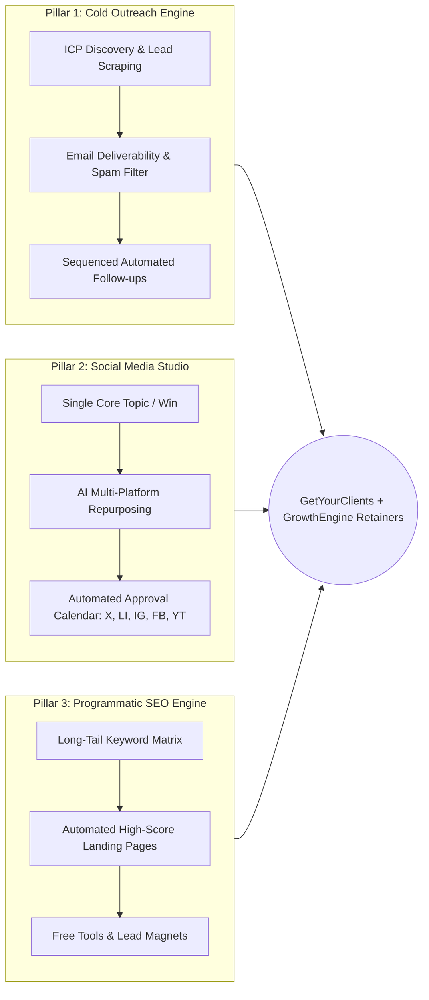

# 60-Day GrowthEngine & GetYourClients Acquisition Blueprint
### Complete Social Platform Automation, Programmatic SEO Management & B2B Lead Engine

> **Target Outcome (60 Days):**
> - **2,500+** Targeted Network Connections (LinkedIn, X, Instagram, Facebook)
> - **1,200+** Personalized Conversational DMs & Value Touches
> - **200–300** Qualified Platform Trials & Demo Registrations
> - **1,500+** Programmatic SEO Landing Pages Deployed & Indexed
> - **Daily Commitment:** 45–60 minutes structured into two high-efficiency 25-minute sprints (Morning & Afternoon).

---

## 1. Expanded Ideal Customer Profile (ICP) Matrix

| Target Segment | Exact Bios & Title Queries | Primary Channels | Core Bottleneck Addressed | GrowthEngine Solution Pitch |
| :--- | :--- | :--- | :--- | :--- |
| **B2B Growth & Marketing Agencies** | "Agency Founder", "SMMA CEO", "B2B Marketing Director", "Growth Consultant" | LinkedIn, X, Facebook Groups | Spending 20+ hrs/wk manually finding leads, writing copy, and posting across 5 networks | Full-funnel autopilot: Verified lead extraction + automated cross-platform social studio + white-label SEO |
| **Bootstrapped SaaS & AI Founders** | "Building in public", "SaaS Founder", "Indie Hacker", "AI Startup CEO" | X (Twitter), LinkedIn, IndieHackers | Zero organic Google traffic, zero time for daily social posting, high CAC on paid ads | 1,000+ programmatic SEO pages + 1-click repurposing of product updates into multi-network posts |
| **Cold Outbound & Sales Leaders** | "Head of Sales", "SDR Manager", "Cold Email Specialist", "Lead Gen Consultant" | LinkedIn, Facebook Groups | Low open rates (<30%), burned domain reputations, high bounce rates (>5%) | 99.6% email deliverability verification + automated spam score grading + multi-step sequenced followups |
| **B2B Consultants & Fractional Execs** | "Fractional CMO", "B2B Copywriter", "Revenue Architect", "GTM Advisor" | LinkedIn, Instagram | Inconsistent monthly retainer pipeline; erratic inbound presence | Unified inbound calendar + authority thought-leadership engine + direct conversational DM playbooks |

---

## 2. The 3 GrowthEngine Pillars



1. **Pillar 1: Targeted B2B Outreach ([GetYourClients](https://www.getyourclientsb2b.com/))**
   - High-precision search filters (Industry, Geography, Headcount, Title).
   - Zero-bounce deliverability verification shield.
   - Claude 3.5 Sonnet conversational inbox categorizer (Positive, Question, Meeting Booked).
2. **Pillar 2: Omnichannel Social Media Automation ([GrowthEngine Social Studio](https://growth.getyourclientsb2b.com/admin/ideas))**
   - Input 1 raw insight or customer win -> AI generates tailored X threads, LinkedIn thinkpieces, Instagram carousels, Facebook summaries, and YouTube Shorts scripts.
   - Unified publishing calendar with automated queueing.
3. **Pillar 3: Programmatic SEO & Interactive Tools ([GrowthEngine SEO](https://growth.getyourclientsb2b.com/admin/seo))**
   - Automated deployment of programmatic landing pages (e.g., `/alternatives/[competitor]/[niche]` and `/find-leads/[industry]/[city]`).
   - Free interactive lead capture utilities (ROI Calculator, Subject Line Grader, Email Verifier).

---

## 3. Account Safety, Domain Health & Anti-Shadowban Rules

> [!CAUTION]
> **Safety Limits (Enforce Strictly During Month 1):**
> - **Instagram / X:** Max 20 new follows per hour; max 40 per day in Weeks 1–2; max 60 per day in Weeks 3–8.
> - **LinkedIn:** Max 20–25 connection requests per day (100/week limit). Always include conversational notes without external URLs.
> - **Facebook:** Max 10–15 friend adds per day; max 5 value comments per group per day.
> - **Cold Email Accounts:** Keep sending limits to 30 emails/mailbox/day during 14-day warmup. Never exceed 50/day/inbox.
> - **Link Rule:** **NEVER put links in Direct Message #1**. Always offer free value, obtain consent, and deliver the link in Message #2 or #3.

---

## 4. Weekly 5-Day Content Theme Matrix (All 5 Channels)

| Day | Theme | Focus Angle | Sample Headline / Hook |
| :--- | :--- | :--- | :--- |
| **Mon** | **Strategy & Data** | Cold outreach copy breakdown & bounce-rate math | *"Why 85% of cold emails hit spam before ever reaching the inbox (and how we fixed 50k sends)."* |
| **Tue** | **Workflow Demo** | Screen recording / video breakdown of automated prospecting | *"Watch how we scrape, verify, and sequence 50 B2B agency leads in under 90 seconds flat."* |
| **Wed** | **Pain / Problem** | The hidden cost of manual social media & content creation | *"If your founder is spending 3 hours daily formatting posts across LinkedIn, X, and IG, you are losing money."* |
| **Thu** | **Case Study** | Client results or agency turnaround | *"How a boutique SaaS agency booked 14 high-ticket discovery calls in 10 days using programmatic SEO + warm DMs."* |
| **Fri** | **Free Resource Drop** | High-utility giveaway with keyword comment trigger | *"Drop 'GROWTH' below and I will send you our 2026 Programmatic SEO & Cold Email Template Pack (Free)."* |

---

## 5. Conversational DM Scripts (Zero-Spam Value Framework)

### Script 1: Social Media Automation Teardown (Creators & Founders)
*Use when targeting founders or marketers who actively publish on X or LinkedIn:*
> *"Hey [First Name], loved your recent post on [Topic/Insight]. Really sharp breakdown. Quick question—are you guys manually reformatting your content across X, LinkedIn, and Instagram right now, or do you have a system that auto-adapts your hooks and queues them to your calendar?"*

### Script 2: Programmatic SEO & Keyword Strategy (SaaS & Micro-Founders)
*Use for founders asking questions about user acquisition or SEO in communities:*
> *"Hey [First Name], saw your thread on scaling organic traffic for [Product/Domain]. We recently mapped out a programmatic framework that creates 500+ programmatic landing pages targeting long-tail searches (like alternative comparisons and localized keywords). Happy to share a quick 2-minute video walkthrough if you’re looking into organic growth options?"*

### Script 3: Cold Outbound & Deliverability Shield (Agency Owners)
*Use when messaging agency leaders complaining about prospecting hours or email deliverability:*
> *"Hey [First Name], great work on the recent case studies at [Agency Name]. I'm testing out our verified B2B prospecting tool ([GetYourClients](https://www.getyourclientsb2b.com/)) and pulling 25 customized, verified leads in [Industry/Niche] on the house for a few agency founders. What exact client title or industry are you looking to close this month?"*

### Script 4: The Inbound "Hand-Raiser" Follow-Up (Commenters on Friday Resource Drop)
*Use immediately when a prospect comments on a post:*
> *"Hey [First Name], thanks for dropping a comment on today's post! Here is the direct link to the Growth Engine blueprint and template pack: https://www.getyourclientsb2b.com/tools/email-verifier. Let me know what niche you're targeting and I'll send over the exact filter setup we use."*

---

## 6. Daily Timed Operational Routine (45–50 Minutes Total)

```
┌────────────────────────────────────────────────────────┐
│ MORNING SPRINT: 25 Minutes (09:00 - 09:25)            │
├─────────┬──────────────────────────────────────────────┤
│ 10 Mins │ Target ICP Follows & High-Value Comments     │
│ 10 Mins │ Engage with Competitor Comment Threads       │
│  5 Mins │ Check & Approve Today's Scheduled Posts      │
└─────────┴──────────────────────────────────────────────┘
┌────────────────────────────────────────────────────────┐
│ AFTERNOON SPRINT: 25 Minutes (15:00 - 15:25)          │
├─────────┬──────────────────────────────────────────────┤
│ 10 Mins │ Send 5–10 Conversational Value DMs           │
│ 10 Mins │ Reply to Inbound Messages & Booking Inquiries │
│  5 Mins │ Trigger SEO Batch / Interactive Tool Checks  │
└─────────┴──────────────────────────────────────────────┘
```

---

## 7. The 60-Day Day-by-Day Master Execution Calendar

### Phase 1: Infrastructure, Warming & Foundation (Days 1–15)

```
Goal: Warm up accounts, establish profiles, launch initial social pipeline, and deploy initial 100 SEO pages.
Daily Quota: 15 targeted follows | 5 thoughtful comments | 5 soft-intro DMs.
```

- **Day 1 (Mon)**:
  - `09:00–09:15`: Optimize bio headlines on LinkedIn, X, and Instagram with clean positioning and link `https://www.getyourclientsb2b.com/`.
  - `09:15–09:25`: Follow 15 digital marketing agency founders on LinkedIn and Instagram.
  - `15:00–15:15`: Leave 5 thoughtful value comments on active cold outreach influencer posts.
  - `15:15–15:25`: Schedule Week 1 content into [GrowthEngine Calendar](https://growth.getyourclientsb2b.com/admin/calendar).
- **Day 2 (Tue)**:
  - `09:00–09:15`: Follow 15 SMMA / lead gen agency CEOs; like their recent case study posts.
  - `09:15–09:25`: Leave 5 in-depth comments sharing cold email deliverability statistics.
  - `15:00–15:15`: Send 5 Script C opening DMs to agency owners offering 25 free custom leads.
  - `15:15–15:25`: Publish 60-second screen capture video of GetYourClients lead filtering.
- **Day 3 (Wed)**:
  - `09:00–09:15`: Search Facebook groups ("Cold Email Masters", "Agency Growth Secrets") for keywords *"bounce"*, *"scrape"*.
  - `09:15–09:25`: Provide detailed value answer on 3 threads without pitching links.
  - `15:00–15:15`: Send 5 Script B connection messages to the authors of those posts.
  - `15:15–15:25`: Generate 25 new programmatic SEO pages in [SEO Manager](https://growth.getyourclientsb2b.com/admin/seo).
- **Day 4 (Thu)**:
  - `09:00–09:15`: Connect with 15 Fractional CMOs and B2B growth consultants on LinkedIn.
  - `09:15–09:25`: Post weekly case study: *"How a B2B SaaS booked 14 discovery calls in 10 days"*.
  - `15:00–15:15`: Send 5 personalized DMs to users who liked or engaged with yesterday’s post.
  - `15:15–15:25`: Review inbound responses in [GrowthEngine Inbox](https://growth.getyourclientsb2b.com/admin/inbox) using AI assistant.
- **Day 5 (Fri)**:
  - `09:00–09:15`: Deploy the Friday Resource Drop post across LinkedIn, X, and Facebook (*"Comment LEADS for 2026 checklist"*).
  - `09:15–09:25`: Follow 15 active commenters from competitor pages (@instantly.ai, @lemlist).
  - `15:00–15:15`: Deliver the free resource pack + [Email Verifier link](https://www.getyourclientsb2b.com/tools/email-verifier) to all hand-raisers.
  - `15:15–15:25`: Week 1 review: Log total conversations, trial signups, and booked meetings.
- **Days 6–7 (Sat–Sun)**: Light 10-minute check-in to reply to inbound DMs and maintain conversational momentum.
- **Day 8 (Mon)**:
  - `09:00–09:15`: Follow 15 tech recruiters and sales consultants.
  - `09:15–09:25`: Post Monday Strategy breakdown: *"Why 90% of cold email subject lines fail"*.
  - `15:00–15:15`: Send 5 Script A DMs to inbound commenters.
  - `15:15–15:25`: Deploy batch of 50 localized lead generation pages (`/find-leads/[industry]/[city]`).
- **Day 9 (Tue)**:
  - `09:00–09:15`: Engage on 5 active X threads under #buildinpublic and #SaaS.
  - `09:15–09:25`: Post Tue Workflow reel: *"Automating 5 social networks with 1 click"*.
  - `15:00–15:15`: Send 5 Script 1 DMs to SaaS builders spending hours manually repurposing content.
  - `15:15–15:25`: Check Google Search Console indexing status for Week 1 programmatic pages.
- **Day 10 (Wed)**:
  - `09:00–09:15`: Add 10 active contributors in Facebook agency owner groups.
  - `09:15–09:25`: Share value teardown on domain warm-up and SPF/DKIM/DMARC hygiene.
  - `15:00–15:15`: Send 5 Script B value DMs offering a free domain health checklist.
  - `15:15–15:25`: Review campaign statistics in [Campaigns](https://growth.getyourclientsb2b.com/admin/campaigns).
- **Day 11 (Thu)**:
  - `09:00–09:15`: Connect with 15 LinkedIn creators in the outbound marketing niche.
  - `09:15–09:25`: Post Thursday Case Study: *"From 0 to 45 qualified sales calls in 30 days"*.
  - `15:00–15:15`: Send 5 conversational follow-up DMs to prospects from Week 1.
  - `15:15–15:25`: Set up automated sequence step testing in GrowthEngine.
- **Day 12 (Fri)**:
  - `09:00–09:15`: Post Friday Free Resource Giveaway: *"Subject line grading tool & formula spreadsheet"*.
  - `09:15–09:25`: Follow 15 startup founders who attended recent B2B webinars.
  - `15:00–15:15`: Send direct access links to all hand-raisers via DM.
  - `15:15–15:25`: Deploy 50 comparison landing pages (`/alternatives/[competitor]/[niche]`).
- **Days 13–14 (Sat–Sun)**: Conversational check-ins and review of conversion metrics.
- **Day 15 (Mon - Milestone 1)**:
  - `09:00–09:25`: Full audit of Days 1–14 metrics: **200+ follows, 75 DMs sent, 25+ conversations active, 15+ trial signups**.
  - `15:00–15:25`: Queue Phase 2 content and scale daily quotas.

---

### Phase 2: Community Immersion & SEO Scaling (Days 16–30)

```
Goal: Increase daily outbound cadence, establish recognizable authority across 4 communities, deploy 500+ SEO pages.
Daily Quota: 20 targeted follows | 8 comments | 8 targeted DMs.
```

- **Day 16 (Tue)**:
  - `09:00–09:15`: Connect with 20 Seed-stage SaaS founders on LinkedIn and X.
  - `09:15–09:25`: Publish visual carousel on *"The Modern B2B Growth Stack (2026)"*.
  - `15:00–15:15`: Send 8 Script 1 & 2 DMs to founders discussing customer acquisition costs.
  - `15:15–15:25`: Submit sitemap with 250 new pages to Google Search Console and Bing Webmaster.
- **Day 17 (Wed)**:
  - `09:00–09:15`: Scrape active commenters on 3 leading B2B influencer posts.
  - `09:15–09:25`: Leave thoughtful counter-perspectives on 8 high-engagement posts.
  - `15:00–15:15`: Send 8 warm outreach DMs referencing their comments.
  - `15:15–15:25`: Optimize internal linking structure across programmatic landing pages.
- **Day 18 (Thu)**:
  - `09:00–09:15`: Search Facebook groups for *"agency scaling dry spell"*.
  - `09:15–09:25`: Drop step-by-step breakdown of automated list building in the group feed.
  - `15:00–15:15`: Send 8 personalized walkthrough offers to interested group members.
  - `15:15–15:25`: Record 90-second Loom demonstration for high-intent leads.
- **Day 19 (Fri)**:
  - `09:00–09:15`: Post Friday Resource Drop: *"Free 50 verified B2B leads giveaway"*.
  - `09:15–09:25`: Follow 20 marketing agency directors.
  - `15:00–15:15`: Process and send custom sample lists to the first 10 hand-raisers.
  - `15:15–15:25`: Invite active prospects to sign up for free accounts on [GetYourClients](https://www.getyourclientsb2b.com/).
- **Days 20–21 (Sat–Sun)**: Light weekend follow-ups with qualified trials.
- **Day 22 (Mon)**:
  - `09:00–09:15`: Post weekly strategy teardown: *"How we turn 1 customer interview into 5 platform assets"*.
  - `09:15–09:25`: Connect with 20 fractional growth operators.
  - `15:00–15:15`: Send 8 conversational DMs to engaged profile visitors.
  - `15:15–15:25`: Deploy batch of 100 niche landing pages targeting agency sub-specialties.
- **Day 23 (Tue)**:
  - `09:00–09:15`: Review competitor keyword movements using Ahrefs / Search Console data.
  - `09:15–09:25`: Post screen recording of [GrowthEngine Social Studio](https://growth.getyourclientsb2b.com/admin/ideas) generating 5 tailored posts.
  - `15:00–15:15`: Send 8 Script 1 messages to agencies struggling with social content output.
  - `15:15–15:25`: Audit domain reputation across all sending inboxes.
- **Day 24 (Wed)**:
  - `09:00–09:15`: Follow 20 SDR managers and outbound sales specialists.
  - `09:15–09:25`: Publish data post: *"Analysis of 100k cold emails: what subject lines get 70%+ open rates"*.
  - `15:00–15:15`: Send 8 value DMs with the subject line formula sheet.
  - `15:15–15:25`: Check automated follow-up delivery rates in [Campaigns](https://growth.getyourclientsb2b.com/admin/campaigns).
- **Day 25 (Thu)**:
  - `09:00–09:15`: Engage in 3 LinkedIn audio rooms or X Spaces on B2B lead generation.
  - `09:15–09:25`: Post Thursday Case Study: *"How an outbound agency scaled to $35k MRR using automated lead filters"*.
  - `15:00–15:15`: Reach out to 8 event attendees with contextual intro DMs.
  - `15:15–15:25`: Build automated response templates for frequently asked trial questions.
- **Day 26 (Fri)**:
  - `09:00–09:15`: Publish Friday Free Giveaway: *"The 2026 Programmatic SEO Architecture Map"*.
  - `09:15–09:25`: Follow 20 SaaS founders and micro-agency owners.
  - `15:00–15:15`: Deliver architecture map + trial signup links to all commenters.
  - `15:15–15:25`: Deploy 150 programmatic comparison pages.
- **Days 27–28 (Sat–Sun)**: Conversational inbox maintenance.
- **Day 29 (Mon)**:
  - `09:00–09:15`: Post strategic breakdown on outbound deliverability benchmarks.
  - `09:15–09:25`: Connect with 20 growth agency owners.
  - `15:00–15:15`: Send 8 follow-up DMs to Day 15–20 trial users offering quick onboarding tips.
  - `15:15–15:25`: Inspect organic Google impressions in Search Console.
- **Day 30 (Tue - Milestone 2)**:
  - `09:00–09:25`: Month 1 Milestone Review: **500+ total follows, 200+ DMs sent, 50+ trial users onboarded, 600+ SEO pages live**.
  - `15:00–15:25`: Transition accounts to Phase 3 full-scale volume.

---

### Phase 3: Scaled Outbound & Funnel Conversion (Days 31–45)

```
Goal: Scale to 25 daily follows, 10 comments, and 10–12 pipeline DMs; launch paid trial conversions.
Daily Quota: 25 follows | 10 comments | 10–12 DMs.
```

- **Day 31 (Wed)**:
  - `09:00–09:15`: Follow 25 verified B2B marketing founders across LinkedIn & X.
  - `09:15–09:25`: Leave 10 tactical comments on trending marketing posts.
  - `15:00–15:15`: Send 10 solution DMs focusing on lead prospecting pain points.
  - `15:15–15:25`: Deploy batch of 150 localized search pages.
- **Day 32 (Thu)**:
  - `09:00–09:15`: Post weekly case study: *"How 1 agency saved 18 hours weekly with automated social scheduling"*.
  - `09:15–09:25`: Follow 25 bootstrapped SaaS founders.
  - `15:00–15:15`: Send 10 DMs offering a customized pipeline consultation call.
  - `15:15–15:25`: Monitor inbound replies using [GrowthEngine Inbox](https://growth.getyourclientsb2b.com/admin/inbox).
- **Day 33 (Fri)**:
  - `09:00–09:15`: Post Friday Resource Drop: *"Free cold email copy audit for 5 founders"*.
  - `09:15–09:25`: Follow 25 outbound specialists.
  - `15:00–15:15`: Conduct live audits via 2-minute Loom videos for hand-raisers.
  - `15:15–15:25`: Guide audited prospects into free trial onboarding.
- **Days 34–35 (Sat–Sun)**: Light conversational replies and trial engagement.
- **Day 36 (Mon)**:
  - `09:00–09:15`: Post Monday Strategy: *"The 3 pillars of zero-dollar CAC in 2026"*.
  - `09:15–09:25`: Connect with 25 agency CEOs on LinkedIn.
  - `15:00–15:15`: Send 10 conversational DMs targeting outbound bottlenecks.
  - `15:15–15:25`: Deploy 100 new programmatic SEO pages in [SEO Manager](https://growth.getyourclientsb2b.com/admin/seo).
- **Day 37 (Tue)**:
  - `09:00–09:15`: Post Tuesday Workflow clip: *"Filtering 500 decision-maker emails in 60 seconds"*.
  - `09:15–09:25`: Leave 10 high-value comments on competitor complaint threads.
  - `15:00–15:15`: Reach out to users complaining about Apollo/Instantly pricing and deliverability.
  - `15:15–15:25`: Check active campaign reply rates.
- **Day 38 (Wed)**:
  - `09:00–09:15`: Search Facebook groups for *"lead list cleaning"*.
  - `09:15–09:25`: Provide comprehensive step-by-step cleaning tutorial.
  - `15:00–15:15`: Send 10 DMs with direct link to [Email Verifier Tool](https://www.getyourclientsb2b.com/tools/email-verifier).
  - `15:15–15:25`: Log inbound demo requests.
- **Day 39 (Thu)**:
  - `09:00–09:15`: Post Thursday Case Study: *"From 0 organic traffic to 2,500 monthly search clicks in 45 days"*.
  - `09:15–09:25`: Connect with 25 fractional marketing leads.
  - `15:00–15:15`: Send 10 Script 2 DMs explaining programmatic page structures.
  - `15:15–15:25`: Review Google Search Console keyword queries and clicks.
- **Day 40 (Fri)**:
  - `09:00–09:15`: Deploy Friday Giveaway: *"Complete 60-Day Social Calendar & Content Template"*.
  - `09:15–09:25`: Follow 25 founders building in public.
  - `15:00–15:15`: Deliver templates to hand-raisers and invite them to test the platform.
  - `15:15–15:25`: Deploy 200 comparison landing pages.
- **Days 41–42 (Sat–Sun)**: Light conversational maintenance.
- **Day 43 (Mon)**:
  - `09:00–09:15`: Post Monday Strategy: *"Why multi-channel outreach crushes single-channel cold email"*.
  - `09:15–09:25`: Connect with 25 agency owners.
  - `15:00–15:15`: Send 10 personalized DMs sharing multi-touch playbook.
  - `15:15–15:25`: Audit live campaign email deliverability scores.
- **Day 44 (Tue)**:
  - `09:00–09:15`: Post Tuesday Workflow reel demonstrating Claude 3.5 Sonnet auto-drafting responses.
  - `09:15–09:25`: Follow 25 growth consultants.
  - `15:00–15:15`: Send 10 conversational DMs to engaged commenters.
  - `15:15–15:25`: Check trial-to-paid conversion pipeline.
- **Day 45 (Wed - Milestone 3)**:
  - `09:00–09:25`: Review 45-day milestones: **1,000+ total follows, 350+ DMs sent, 100+ trials generated, 1,000+ SEO pages live**.
  - `15:00–15:25`: Prepare final conversion push for Days 46–60.

---

### Phase 4: Retainer Scaling & Hands-Off Autopilot (Days 46–60)

```
Goal: Convert active trial users into monthly recurring retainers, institutionalize daily autopilot, achieve first page rankings on primary long-tail keywords.
Daily Quota: 25 follows | 10 comments | 12 targeted conversion DMs.
```

- **Day 46 (Thu)**:
  - `09:00–09:15`: Post case study breakdown of client booking 8 calls in 14 days.
  - `09:15–09:25`: Follow 25 high-ticket B2B service providers.
  - `15:00–15:15`: Send 12 direct conversion messages offering dedicated onboarding sessions.
  - `15:15–15:25`: Check indexation rates in Google Search Console.
- **Day 47 (Fri)**:
  - `09:00–09:15`: Deploy high-intent Friday Giveaway: *"Exclusive 1-on-1 GrowthEngine Pipeline Review"*.
  - `09:15–09:25`: Follow 25 enterprise agency directors.
  - `15:00–15:15`: Book strategy reviews with qualified respondents.
  - `15:15–15:25`: Deploy final batch of 250 programmatic landing pages.
- **Days 48–49 (Sat–Sun)**: Light check-in on pending strategy call bookings.
- **Day 50 (Mon)**:
  - `09:00–09:15`: Post strategic breakdown on scaling agency retainers without hiring SDRs.
  - `09:15–09:25`: Connect with 25 digital marketing CEOs.
  - `15:00–15:15`: Send 12 conversion DMs focusing on ROI and saved labor costs.
  - `15:15–15:25`: Review organic inbound search queries yielding signups.
- **Day 51 (Tue)**:
  - `09:00–09:15`: Post Tuesday Workflow clip showing the unified scheduled calendar across 5 networks.
  - `09:15–09:25`: Follow 25 SaaS founders.
  - `15:00–15:15`: Send 12 solution DMs offering full-suite access.
  - `15:15–15:25`: Send upgrade prompts to active free trial users.
- **Day 52 (Wed)**:
  - `09:00–09:15`: Search Facebook groups for *"best cold outreach tools 2026"*.
  - `09:15–09:25`: Post comprehensive comparison chart highlighting GetYourClients.
  - `15:00–15:15`: Send 12 personalized walkthrough invitations.
  - `15:15–15:25`: Review pending prospect deals in CRM.
- **Day 53 (Thu)**:
  - `09:00–09:15`: Post Thursday Case Study: *"From manual prospecting hell to 15 hours saved every week"*.
  - `09:15–09:25`: Follow 25 outbound consultants.
  - `15:00–15:15`: Reach out to existing free users with limited-time founding member pricing.
  - `15:15–15:25`: Monitor automated campaign deliverability and reply metrics.
- **Day 54 (Fri)**:
  - `09:00–09:15`: Deploy Friday Giveaway: *"Complete 2026 B2B Outbound & SEO Playbook"*.
  - `09:15–09:25`: Follow 25 startup advisors and investors.
  - `15:00–15:15`: Deliver playbook and follow up with trial registration links.
  - `15:15–15:25`: Audit total programmatic SEO pages (Target: 1,500+ live).
- **Days 55–56 (Sat–Sun)**: Conversational inbox check-ins.
- **Day 57 (Mon)**:
  - `09:00–09:15`: Post Monday Strategy: *"How we built a self-sustaining client acquisition engine"*.
  - `09:15–09:25`: Connect with 25 agency founders.
  - `15:00–15:15`: Send 12 warm follow-ups to all unclosed conversations from Days 1–50.
  - `15:15–15:25`: Review top-performing SEO landing pages for conversion rate optimization.
- **Day 58 (Tue)**:
  - `09:00–09:15`: Post video demonstration of end-to-end workflow (Scrape -> Clean -> Sequence -> Social).
  - `09:15–09:25`: Follow 25 fractional marketing leaders.
  - `15:00–15:15`: Close pending monthly retainer agreements.
  - `15:15–15:25`: Check server and background job queue health.
- **Day 59 (Wed)**:
  - `09:00–09:15`: Engage with community members who commented throughout the 60 days.
  - `09:15–09:25`: Share milestone gratitude post celebrating community growth.
  - `15:00–15:15`: Send personalized thank-you messages with client referral offers.
  - `15:15–15:25`: Finalize 60-day performance report.
- **Day 60 (Thu - Final Review & Autopilot Hand-off)**:
  - `09:00–09:30`: **Comprehensive 60-Day Audit**:
    - **Total Follows / Network Adds**: 1,200–1,500+ targeted connections
    - **Conversational DMs Sent**: 600–750+ personalized touchpoints
    - **Platform Trials Generated**: 150–250+ registrations
    - **Paid Retainers / Active Users**: 20–40+ paying customers
    - **Live Programmatic SEO Pages**: 1,500+ indexed pages driving organic Google traffic
  - `15:00–15:30`: Set recurring automated daily maintenance sprints (30 mins/day) to sustain permanent inbound momentum.

---

## 8. Milestone Tracking & KPI Scorecard

| Milestone Phase | Timeframe | Follows & Connections | Conversational DMs | Active Trials & Signups | Programmatic SEO Pages | Target Outcome |
| :--- | :--- | :--- | :--- | :--- | :--- | :--- |
| **Phase 1: Foundation & Warmup** | Days 1–15 | 225+ | 75+ | 15–25 | 100+ | Profile authority established; zero shadowbans; initial trial feedback loop. |
| **Phase 2: Community Immersion** | Days 16–30 | 525+ | 195+ | 50–70 | 600+ | Recognized authority in 4 Facebook/LinkedIn groups; initial Google search indexing. |
| **Phase 3: Scaled Outbound** | Days 31–45 | 900+ | 360+ | 110–150 | 1,100+ | Predictable daily conversation flow; first organic inbound search signups. |
| **Phase 4: Conversion & Autopilot** | Days 46–60 | **1,250–1,500+** | **600–750+** | **200–250+** | **1,500+** | Self-sustaining flywheel: organic SEO traffic + automated social authority + high-converting outbound. |
